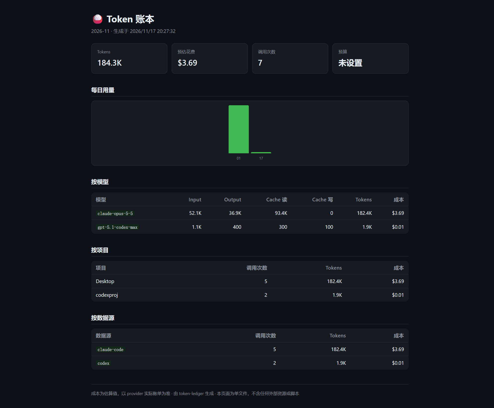

# Token 账本 🍚

**本地优先的个人 AI 花费账本。** 把各个 coding agent 烧掉的 token 汇成一册，回答一个官方账单页不回答的问题：**这个月还剩多少、还能撑几天。**

> Token Ledger — a local-first ledger for the tokens your AI coding agents burn.
> No account, no upload, no prompt content. Just numbers you own.

零运行时依赖 · 一条命令 · 单一 SQLite 文件 · 不需要联网。

---

## 这是「账本」，不是「仪表盘」

[ccusage](https://github.com/ccusage/ccusage) 这类工具做的是**监控**：告诉你花了多少。
账本回答的是另一个问题：**预算还剩多少，剩下的日子每天还能吃几碗。**

| | 仪表盘 | 账本 |
| --- | --- | --- |
| 回答 | 我花了多少？ | 我还能花多少？ |
| 单位 | 一次调用 | 一个月 |
| 终点 | 一张报表 | 一个余额数字 |

所以要做的不是「又一个 ccusage」，而是它没做的那一半。

## 快速开始

需要 **Node.js ≥ 22.18**。运行时**零依赖**；仓库里可以直接 `node src/cli.ts` 跑（靠 Node 原生类型剥离），
发布到 npm 的包则是编译后的 JS——因为 Node 不允许在 `node_modules` 里剥离类型。

```bash
# 从源码运行（当前版本）
git clone https://github.com/1416459545-bot/token-ledger.git
cd token-ledger
node src/cli.ts scan      # 扫描本地 Claude Code 日志
node src/cli.ts report    # 看本月的账
```

> **还没发布到 npm，但可以直接从 GitHub 安装运行：**
>
> ```bash
> npx github:1416459545-bot/token-ledger scan
> npx github:1416459545-bot/token-ledger report
> ```
>
> 安装时会自动构建（`prepare` 钩子），装完就是编译好的 JS，不需要你本机有 TypeScript。

真实输出长这样：

```text
Token 账本 · 2026-11
──────────────────────────────────────────
合计      182.4K tokens    ≈ $3.69   共 5 次调用
构成      input 52.1K · output 36.9K · cache读 93.4K · cache写 0

按模型
MODEL            INPUT  OUTPUT  CACHE-R  CACHE-W  TOKENS   COST
───────────────  ─────  ──────  ───────  ───────  ──────  ─────
claude-opus-5-5  52.1K   36.9K    93.4K        0  182.4K  $3.69

按天
DAY         CALLS  TOKENS   COST
──────────  ─────  ──────  ─────
2026-11-01      5  182.4K  $3.69

预算
  月预算 $50.00 · 已花 $3.69 · 剩余 $46.31
  含今天还剩 14 天 → 每天还能吃 $3.31
```

## 命令

| 命令 | 作用 |
| --- | --- |
| `scan` | 扫描本地日志并入库（增量：没改动的文件自动跳过） |
| `import <file.jsonl>` | 导入任意工具的用量数据（通用 JSONL 格式） |
| `comment` | 在 PR 里发布/更新用量评论（供 GitHub Action 使用） |
| `report` | 看某个月的账，默认本月 |
| `budget set <金额>` | 设定月度预算（美元） |
| `budget show` | 看余额、剩余天数、日均还能花多少 |
| `budget clear` | 清掉预算 |
| `export` | 导出 Markdown / CSV / JSONL / 单文件 HTML 看板 |
| `rice` | 看看这个月吃了几碗白饭（1 碗 = 100 万 tokens） |
| `doctor` | 诊断：路径对不对、数据量、价格表状态 |

常用选项：

```bash
node src/cli.ts report --month 2026-10        # 指定月份
node src/cli.ts report --last 7d              # 最近 7 天（含今天）
node src/cli.ts report --since 2026-11-01 --until 2026-11-15  # 任意区间
node src/cli.ts report --by project           # 只看某一个维度
node src/cli.ts scan --source codex         # 只扫某一个数据源（claude-code / codex / all）
node src/cli.ts scan --source codex --root ~/my-logs  # 自定义日志目录（需配合 --source）
node src/cli.ts scan --force                  # 忽略增量缓存，全量重扫
node src/cli.ts export --format csv --out 2026-11.csv
node src/cli.ts report --json                 # 机器可读
```

运行 `node src/cli.ts help` 看完整列表。

## 时间区间

除了整月，还能看任意区间：

```bash
node src/cli.ts report --last 7d                              # 最近 7 天
node src/cli.ts report --since 2026-11-01 --until 2026-11-15  # 任意区间
node src/cli.ts export --format html --last 30d               # 近 30 天的看板
```

- `--month` / `--last` / `--since(--until)` **三选一**，同时给会报错。
- 只给 `--since` 就统计到今天；只给 `--until` 就统计那一天。
- 区间不是完整自然月时**不显示月度预算**（预算本身是月度的，硬套没有意义）。
- HTML 看板会额外画出**近 6 个月趋势**。

## 多机合并

两台电脑各有一个账本？`export --format jsonl` 导出的是**事件级**数据，格式与 `import` 完全兼容：

```bash
# 机器 A
node src/cli.ts export --format jsonl --month 2026-11 --out from-a.jsonl

# 机器 B
node src/cli.ts import from-a.jsonl
node src/cli.ts report --month 2026-11
```

- 事件主键是内容哈希，**重复导入不会重复记账**，可以反复合并、放心重跑。
- 只导出 token 数字与元数据，**不含任何 prompt / 回复内容**。
- 来源标识会保留：合并后 `claude-code` / `codex` 不会被抹成 `import`。

## 单文件 HTML 看板

```bash
node src/cli.ts export --format html --month 2026-11
# 已写入 token-ledger-2026-11.html（默认文件名，可用 --out 指定）
```

一份**完全自包含**的 HTML：零外部 CSS / JS / 字体 / 图片，**断网双击就能打开**，自动适配深色 / 浅色主题。



> 默认写文件而不是输出到终端——PowerShell 的 `>` 重定向会写成 UTF-16，会把页面弄坏。

## 它做什么 / 不做什么

**支持：**

- ✅ Claude Code（`~/.claude/projects` 下的 `.jsonl` 会话日志）
- ✅ Codex CLI（`~/.codex/sessions/YYYY/MM/DD/rollout-*.jsonl`）
- ✅ 输入 / 输出 / 缓存读 / 缓存写 四类 token 分开记账
- ✅ 跨项目、跨模型、跨天聚合
- ✅ 预算与「日均还能吃多少」
- ✅ 自定义模型价格表
- ✅ 通用 JSONL 导入：还没适配的工具，只要导出用量就能记账
- ✅ 未知模型不瞎猜价格，标 `n/a` 并提示你补

**暂不支持：**

- ❌ Gemini CLI 等其它数据源（Roadmap）
- ❌ 代理模式（拦截真实请求）
- ❌ Web 界面、团队协作、云同步

> 少做点功能，才有可能真的发出去。

## 导入任意工具的用量数据

还没适配你的工具？只要它能把用量导出成 JSONL，就能进账本：

```bash
node src/cli.ts import usage.jsonl --project my-app
```

每行一条 JSON，只有三个必填字段：

```json
{"ts":"2026-11-10T10:00:00Z","model":"gpt-4o","input_tokens":1000,"output_tokens":500}
```

| 字段 | 说明 |
| --- | --- |
| `ts` / `timestamp` | 必填，任何能被 `Date` 解析的时间 |
| `model` | 必填，用于查价格表 |
| `input_tokens` / `output_tokens` | 至少填一个 token 字段 |
| `cache_read_tokens` / `cache_write_tokens` | 可选 |
| `provider` / `project` / `session_id` | 可选 |

- 字段同时接受 camelCase（如 `inputTokens`）。
- 空行与 `#` 开头的行会被忽略。
- **重复导入不会重复记账**：主键是内容哈希。
- 没写 `project` 的行可以用 `--project` 统一补上。

## GitHub Action：在 PR 里看 token 花费

仓库根目录就是 Action 本体（composite action，零依赖、无需构建）：

```yaml
permissions:
  contents: read
  pull-requests: write # 发评论需要

steps:
  - uses: actions/checkout@v4

  # 这里放你跑 AI agent 的步骤（如果有）

  - uses: 1416459545-bot/token-ledger@v0.4.0
    with:
      github-token: ${{ secrets.GITHUB_TOKEN }}
      # import-file: path/to/usage.jsonl
```

评论长这样，且 **同一条评论会被更新而不是刷屏**：

```markdown
### 🍚 Token 账本 · 2026-11

| 调用次数 | Tokens | 预估花费 |
| --- | --- | --- |
| 7 | 184.3K | $3.69 |

**按模型**
| 模型 | Tokens | 预估花费 |
| --- | --- | --- |
| `claude-opus-5-5` | 182.4K | $3.69 |
| `gpt-5.1-codex-max` | 1.9K | $0.01 |
```

⚠️ **数据从哪来**（这条必须说清楚）：Action 跑在 GitHub runner 上，**看不到你本地的日志**。两条路：

1. **AI agent 就在 CI 里跑**（例如 claude-code-action）→ 日志落在 runner 上，直接可用；
2. 用量在别处 → 先作为 artifact 下载，再用 `import-file` 传入通用 JSONL。

没找到数据时，评论会明确写「没有找到可统计的用量记录」，而不是贴一个 0。

本地预览评论内容（不发起请求）：

```bash
node src/cli.ts comment --repo owner/repo --issue 1 --dry-run
```

## 隐私承诺

这是本项目**唯一不可妥协的设计**：

- 只读取日志里的 **token 数字与模型元数据**，**从不保存** prompt、回复、代码内容。
- 数据只存在本机 `~/.token-ledger/ledger.db`，**不上传、不联网**。
- 没有账号、没有遥测、没有「匿名统计」。
- 数据结构层面就保证了：`UsageEvent` 里根本没有存放文本正文的字段。

## 数据在哪

```text
~/.token-ledger/
├── ledger.db     # SQLite 账本（events / files / budgets / meta）
└── prices.json   # 可选：自定义价格表
```

用 `TOKEN_LEDGER_HOME` 可以整体搬家：

```bash
TOKEN_LEDGER_HOME=~/my-ledger node src/cli.ts report
```

删除 `~/.token-ledger/` 就等于清空账本，不影响你的 Claude Code 日志。

## 自定义价格表

内置价格表只是**常见公开报价的量级**，用于估算，不是账单。遇到新模型（或想用你自己的合同价），在 `~/.token-ledger/prices.json` 里覆盖：

```json
{
  "models": {
    "claude-opus-5-5": {
      "provider": "anthropic",
      "input": 15,
      "output": 75,
      "cacheRead": 1.5,
      "cacheWrite": 18.75
    }
  }
}
```

- 单位统一是 **美元 / 每 100 万 tokens**。
- `cacheRead` 默认 `0`，`cacheWrite` 默认等于 `input`。
- 键名会被规范化（去掉 provider 前缀、日期后缀），匹配时**最长优先**：`gpt-4o-mini` 不会被 `gpt-4o` 抢走。
- 内置表按「模型族」匹配，所以 `claude-opus-5-5` 会近似命中 `claude-opus` 并把成本标为估算值。

> ⚠️ 成本为**估算值**，以 provider 实际账单为准。

## 设计取舍（给想改代码的人）

- **幂等入库**：事件主键 `claude-code:<message.id>`，重复 `scan` 不会重复记账。
- **增量扫描**：记录每个文件的 `mtime + size`，没变就跳过；`--force` 全量重扫也不会重复。
- **成本可为 `NULL`**：未知模型记 `n/a`，聚合时 `SUM` 自动忽略，不污染总额。
- **零依赖**：只用 Node 内置的 `node:sqlite`、`node:fs`、`node:test`。没有 `node_modules`。

## Roadmap

- [x] **v0.1** — Claude Code 源、报表、预算、导出、白饭彩蛋
- [x] **v0.2** — Codex CLI 源、`import` 通用导入、多源 `scan --source`
- [x] **v0.3** — 单文件 HTML 看板（在 0.5.0 中交付：`export --format html`）
- [x] **v0.4** — GitHub Action：在 PR 里评论 token 用量与预估花费（同一条评论幂等更新）
- [x] **v0.6** — 时间区间（`--last` / `--since` / `--until`）、多机合并（`export --format jsonl`）、6 个月趋势图
- [ ] 长期 — 云同步（用户自带网盘）、团队视图

## 开发

```bash
node --test             # 跑测试（不需要 npm install）
node src/cli.ts doctor  # 自己诊断一下
```

没有构建步骤：Node 直接执行 TypeScript。新增数据源 = 写一个 `src/sources/xxx.ts` 导出 `parse*File()`，再用 `src/core/scanner.ts` 串起来。

细节见 [CONTRIBUTING.md](CONTRIBUTING.md)。

## License

[MIT](LICENSE) © 2026 Token Ledger contributors

---

## English

**Token Ledger** is a local-first ledger for the tokens your AI coding agents burn.

It reads local session logs (Claude Code, more sources coming), stores **only token counts and model metadata** in a single SQLite file, and turns them into a monthly ledger: spend, budget, remaining, and "how much is left per day".

No account, no upload, no prompt content, no runtime dependencies. Requires Node.js ≥ 22.18.

```bash
node src/cli.ts scan && node src/cli.ts report
```

Costs are estimates based on public price tables — always falling back to `n/a` rather than guessing for unknown models.
